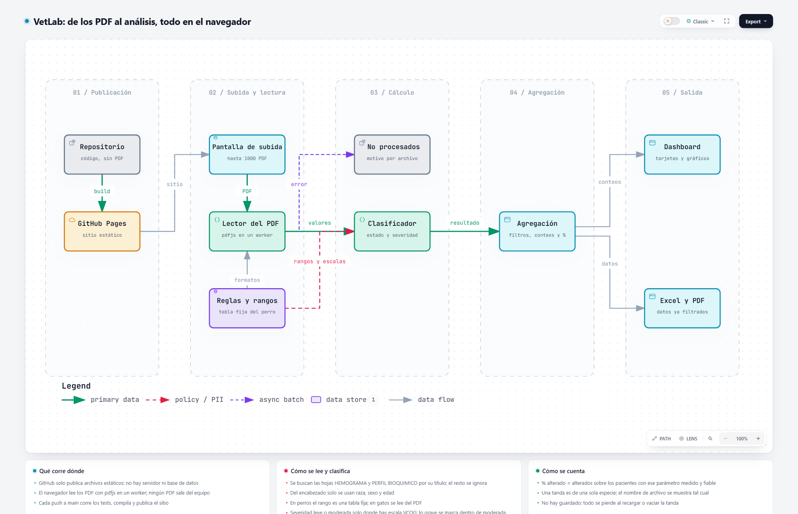

# VetLab

Análisis estadístico de hemogramas y perfil bioquímico veterinario, a partir de los informes en PDF de Analítica Lab. Funciona **100% en el navegador**: los PDF se leen en tu equipo, no se envían a ningún servidor y no se guarda historial.

**Sitio:** `https://<usuario>.github.io/vet-app/`

## Cómo se usa

1. Abre el sitio y arrastra los PDF de una tanda (hasta 1000 archivos, de una sola especie).
2. Si algún nombre se repite, la app avisa y pregunta si quieres subir también las copias. Puedes buscar entre los archivos cargados.
3. Pulsa **Analizar tanda**.
4. En **Resultados** revisa las tarjetas y gráficos generales, y la tabla de detalle por parámetro (pestañas Hemograma y Bioquímico). Filtra por sexo, raza y edad.
5. Exporta a **Excel** (hojas de resumen, por analito y detalle de ambos paneles) o a **PDF** (imprimir).

Al recargar la página o vaciar la tanda, los datos se pierden: no hay guardado.

## Qué lee de cada PDF

- **Hemograma** (16 parámetros) y **perfil bioquímico** (15 parámetros). Se ignoran coagulación, electrolitos y cualquier otra hoja.
- Un PDF sin la hoja del perfil bioquímico se rechaza y aparece en la lista de archivos no procesados, con el motivo.
- Del encabezado solo se usan raza, sexo y edad. No se extraen nombre, ficha ni médico.

## Cómo se clasifica

- **Alto o bajo:** el valor queda fuera del rango de referencia. En perros el rango es una tabla fija (`src/reglas.js`, tomada de un informe de Analítica Lab); en gatos se lee del propio PDF.
- **Severidad leve o moderada** solo donde hay escala VCOG-CTCAE v2 (LeBlanc et al. 2021, *Vet Comp Oncol*): lo grave (≥G3) se marca dentro de moderada. Donde no hay escala, solo alto o bajo.
- **Porcentaje alterado:** pacientes alterados sobre los que tienen ese parámetro medido y fiable. Un paciente está alterado si tiene al menos un parámetro alto o bajo.
- Plaquetas con agregados en el frotis se marcan "no fiables" y quedan fuera del conteo.

> Las escalas de severidad del perfil bioquímico están **pendientes de verificar** contra la tabla original (`src/reglas.js`). Esta herramienta es de apoyo estadístico: la interpretación de los exámenes corresponde al médico veterinario.

## Arquitectura

Flujo de datos, desde la publicación en GitHub Pages hasta el dashboard y las exportaciones. Todo ocurre en el navegador; no hay servidor.

<picture>
  <source media="(prefers-color-scheme: dark)" srcset="docs/arquitectura-oscuro.png">
  
</picture>

## Datos de pacientes

Los PDF de laboratorio contienen datos de pacientes. No los subas al repositorio: `*.pdf` y `fixtures/` están en `.gitignore`. Los nombres de archivo se muestran tal cual en pantalla y en las exportaciones, así que evita compartirlas si el nombre identifica al paciente.

## Desarrollo

Requiere Node.js 20 o superior.

```
npm install
npm run dev      # http://localhost:3000
npm test
npm run build    # genera out/ (sitio estático; basePath /vet-app, o BASE_PATH si está definida)
```

Las pruebas con un PDF real (`test/muestra.js`) solo corren si existe `fixtures/muestra-canino.pdf` en tu equipo.

Estructura:

- `src/parse.js`: lee el PDF (`pdfjs-dist`) por coordenadas de texto.
- `src/reglas.js`: analitos, rangos de referencia y escalas de severidad.
- `src/clasificar.js`, `src/agregar.js`: clasificación por analito y conteos.
- `src/exportar.js`: Excel.
- `app/`: interfaz (Next.js, exportación estática).

## Publicar en GitHub Pages

1. Crea el repositorio en GitHub (con cualquier nombre; la ruta base se toma sola del nombre del repositorio).
2. En **Settings → Pages**, elige **Source: GitHub Actions**.
3. Cada push a `main` ejecuta `.github/workflows/deploy.yml`: corre los tests, compila y publica.
